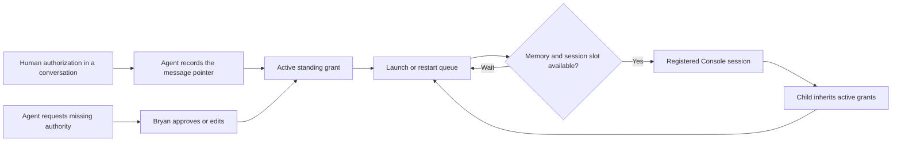

# Standing grants for Console agents

Bryan can authorize broad work once, then let agents launch, restart, close their own helpers and delegate within that scope.
The backend stores the authority in SQLite and supplies it to each session.
Agents interpret the work scope cooperatively. Console checks the active record, action, project, model and resources before a launch.



## Create authority from Bryan's message

When Bryan says “I authorize you to do whatever is needed on the planner overnight,” preserve that broad scope.
Use `agent_grants list` to get the latest Console human message and its `humanMessageId`.
Then use `record` with a definition and that pointer. The grant becomes active immediately.

Console reads the original input record in the same conversation. It retains Bryan's complete message as provenance.
The definition's scope describes the authorization and its constraints. Separate instructions to the lead remain in the original message.
Repeated recording for the same human message and grantee returns the existing grant, including its revocation or expiry.
Renewed authority needs a new human message or an approved request.

```json
{
  "action": "record",
  "humanMessageId": "live:<console-session-id>:<byte-offset>",
  "definition": {
    "grantee": { "kind": "assignment", "id": "<assignment-id>" },
    "actions": ["launch_session", "restart_session", "close_session"],
    "scope": "Do whatever is needed on the planner overnight, including helpers.",
    "projectSlugs": [],
    "limits": { "maxConcurrentSessions": null, "models": [] },
    "expiry": { "kind": "until_revoked" }
  }
}
```

The grantee can be a Console session, an assignment, or any agent in a configured project.
Empty `projectSlugs` permits configured projects within the work scope. Empty `models` permits any model.
Null concurrency follows available memory. Expiry defaults to `until_revoked`.
Bryan can choose `assignment_finished` with a parent assignment ID instead.

## Request missing authority once

If existing grants do not cover the work, use `request` with one broad definition and a plain reason.
Continue other authorized work while the request is pending.
The grants page shows **Approve**, **Edit** and **Deny**, with the scope first.
Approval records Bryan's decision, activates the grant and wakes the requester through the existing continuation path.
Drafts, manual pauses, native choices and memory pressure still defer wake.

Enable notifications on the grants page at the Console's HTTPS address.
Each browser must grant notification permission once. The server retains its push subscription and VAPID keys in SQLite.

Notifications offer Approve, Edit and Deny; browsers can limit the number of visible action buttons.
Edit opens the retained request. Approve and Deny use the current login and CSRF token.
An expired login or unavailable connection opens the request for a normal browser decision.
The localhost development app disables PWA workers, so notifications require the HTTPS app.

## Launch and restart real sessions

`agent_grants launch` accepts `projectSlug`, `provider`, `model`, `effort`, `flags`, `prompt`, `title` and `supervisorId`.
Providers are `codex` and `claude`. The backend uses the same session manager and provider commands as the UI.
The session appears in the list as **Launched by** its launcher.
Use `launch_status` with the returned request ID to obtain the native assignment after registration.

`restart` takes the original `sessionId`. It preserves the native conversation, assignment and inbox.
Current work, drafts and provider choices defer restart. Finished or manually paused sessions cannot restart automatically.

`close` takes a `sessionId` and an optional `requestId`/`grantId`. It requires an active grant with `close_session` and a session whose stored `launchedBy` is the calling assignment. Sharing a grant or supervising another agent does not permit closing that agent's other sessions. Human-created sessions are outside this agent action.

```json
{ "action": "close", "sessionId": "<owned-console-session-id>", "requestId": "<unique-request-id>" }
```

Close stops the owned provider and releases its Work binding, while keeping native history available in Browse. It waits until the native transcript is indexed and readable. It does not wait for launch memory, a session slot, an idle prompt or a model selection. Project/model settings that prevent new launches do not prevent cleanup under a covering close grant. Ownership and current authority are checked again under the session command lock. Reusing the request ID retrieves that original close; it cannot close a different session. Use `launch_status` to inspect the durable result. Closed bindings are never automatically recovered.

New grant definitions include launch, restart and close by default. Existing records retain their explicit actions; they do not gain `close_session` automatically. Bryan can approve that action in a new broad grant. Agents with a cached MCP schema use `node scripts/agent-coord.mjs grants` with the same JSON; the helper obtains their credentials.

An agent-created session whose assignment is finished and whose native process has exited is archived automatically once its indexed native transcript is readable. It leaves Work, retains Browse history and is not restored by polling, reconciliation or recovery. Missing history defers archival without restarting the finished helper. Live native processes, unknown liveness, human-created conversations and manual suspension remain protected. A human can explicitly resume a manually suspended conversation.

The provider recovery controller handles capacity failures and unexpected process exits with bounded backoff.
Useful output resets its consecutive failure budget. A new running turn clears the visible retry notice.

Each request reserves one session ID before launch. Requests survive a backend restart.
Retry with the same `requestId` to retrieve the same action rather than launch another session.
The queue checks `MemAvailable` against the configured pressure floor plus 250 MiB per new session.
It waits for memory or the grant's concurrent-session slot, then continues without another approval.
`launch_status` explains queued, starting, completed, failed and cancelled session actions.
Use `cancel` with the original `requestId` to withdraw your own queued action, including launch,
restart or close. Cancellation needs no new grant and survives backend restart. Every queue
transition checks its expected current state, including memory-wait retries. A request that has
already started returns its current state and session identity with a too-late result; cancellation
never kills a running session. Reusing the request ID cannot relaunch cancelled work.
The authenticated grants page lists pending session actions, their waiting reasons, available
memory and launch requirement, and lets Bryan cancel a queued request. Changing a brief does
not cancel a stored request.

## Inherit and relay existing scope

The backend creates the opening authority stamp from the stored grant, launcher and opening task.
Native context supplies the current grants separately from peer-message JSON.
Claude also receives the backend's scope records through its native `--append-system-prompt` on launch and resume.
That authority arrives before MCP connects. Native records omit the lead's separate procedural instructions from the full provenance message.
Children inherit the launcher's active grant IDs and start with unattended continuation and the declared supervisor.
Their provider MCP configuration carries the Console session ID explicitly, so registration works before a browser opens the session.
Native lifecycle hooks must use the installed canonical `scripts/agent-coord.mjs` from this release.

Peer messages include the grant IDs active for both sender and recipient at delivery.
Honor scope relayed within that shared grant. Ask Bryan only when the work needs authority beyond the grant.
Revocation and parent-finish expiry remove inherited authority immediately and cancel queued actions.
Revoke pauses launched assignments that have no other active grant. It does not interrupt a command already running.

The grants page includes the use log and one-click revoke.
If a running MCP connection has an older schema, use the canonical helper with JSON on stdin:

```bash
node /home/bryan/code/UberCoder/agent-console-mvp/agent-console/scripts/agent-coord.mjs grants < request.json
```

The helper supplies the existing agent credentials. Run it from the native agent process.

## Verify and activate

Run `agent-grants`, `agent-grant-push`, `agent-session-launches` and provider tests, then the grants page tests.
Run the opt-in real-session proofs described in [Running Tests](agent_docs/running_tests.md).
Deploy backend, browser, shared contracts and the canonical helper together.
Migrations 16 and 17 add grant records, uses, subscriptions, launch requests and session launch context.
Back up SQLite and installed builds before activation. Verify schema, served assets and surviving native process identities after restart.
